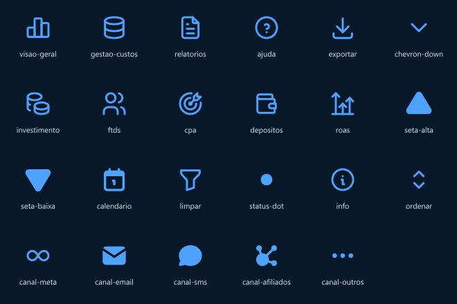

# Ícones SVG — tela de referência (P1.4)

Gerados a partir do **[@tabler/icons](https://tabler.io/icons) 3.49.0 (MIT)** por `scripts/gerar-icones.mjs` (`pnpm --filter @trafego/design icones`). Decisão D5: o usuário pediu ícones de biblioteca SVG, sem geração por IA. O script copia o desenho do Tabler e normaliza o contrato: viewBox 24×24, sem `width`/`height`, cor por `currentColor`; ícones de linha com `fill="none" stroke="currentColor" stroke-width="1.75" stroke-linecap="round" stroke-linejoin="round"`, ícones cheios com `fill="currentColor"`. Não edite os `.svg`, o `sprite.svg` nem o `index.ts` à mão: altere o mapa no script e rode de novo.

Por que Tabler e não Lucide: o Tabler tem variante **filled** para os ícones que a imagem mostra cheios (calendário, envelope, balão, triângulos, ponto), e o traço outline é o mesmo estilo que o Lucide. Phosphor e Heroicons têm menos cobertura dos ícones de métrica (alvo com seta, moedas, carteira).

## Formas de uso

- Arquivo solto: `icons/<nome>.svg`.
- Sprite (protótipo estático): `<svg class="icone"><use href="icons/sprite.svg#icone-exportar" /></svg>`.
- TypeScript: `import { icones, type NomeIcone } from './index';` e `icones['exportar']` devolve o markup inline.

## Catálogo

| Nome | Tabler | Uso na tela | Tamanho renderizado |
| --- | --- | --- | --- |
| `visao-geral` | outline `chart-bar` | Menu da sidebar: Visão Geral (item ativo) | 18 px |
| `gestao-custos` | outline `database` | Menu da sidebar: Gestão de Custos | 18 px |
| `relatorios` | outline `file-text` | Menu da sidebar: Relatórios | 18 px |
| `ajuda` | outline `help-circle` | Rodapé da sidebar: Ajuda | 18 px |
| `exportar` | outline `download` | Botão Exportar (cabeçalho) | 18 px |
| `chevron-down` | outline `chevron-down` | Botão Exportar e selects da barra de filtros | 14 px |
| `investimento` | outline `coins` | Tile do KPI Investimento total | 24 px no tile de 44 px |
| `ftds` | outline `users` | Tile do KPI FTDs | 24 px no tile de 44 px |
| `cpa` | outline `target-arrow` | Tile do KPI Custo por FTD | 24 px no tile de 44 px |
| `depositos` | outline `wallet` | Tile do KPI Depósitos no período | 24 px no tile de 44 px |
| `roas` | outline `chart-arrows-vertical` | Tile do KPI ROAS | 24 px no tile de 44 px |
| `seta-alta` | filled `triangle` | Delta positivo nos cards de KPI | 12 px |
| `seta-baixa` | filled `triangle-inverted` | Delta negativo nos cards de KPI | 12 px |
| `calendario` | filled `calendar` | Campo Período da barra de filtros | 14 px |
| `limpar` | outline `filter` | Botão Limpar filtros | 18 px |
| `status-dot` | filled `point` | Ponto verde de "Dados atualizados em" | 10 px |
| `info` | outline `info-circle` | Títulos dos painéis e colunas CPA / ROAS | 14 px |
| `ordenar` | outline `selector` | Cabeçalho ordenável da tabela (Investimento) | 10 px |
| `canal-meta` | outline `infinity` | Tabela por canal: Meta (laço genérico, não o logotipo) | 18 px |
| `canal-email` | filled `mail` | Tabela por canal: Email | 18 px |
| `canal-sms` | filled `message-circle` | Tabela por canal: SMS | 18 px |
| `canal-afiliados` | filled `affiliate` | Tabela por canal: Afiliados | 18 px |
| `canal-outros` | filled `dots` | Tabela por canal: Outros | 18 px |

## Notas de leitura da imagem

- Os tiles de KPI da referência têm fundo escuro tingido (acento a ~30%) e o ícone colorido (azul, rosa, verde-água), não ícone branco sobre fundo cheio. Como a cor vem de `currentColor`, basta definir `color` no tile.
- Os ícones da biblioteca não são cópia pixel a pixel dos da imagem; a 10–24 px a diferença pesa muito pouco no diff de 2% (ver `design/componentes.md`, orçamento do diff). Se um ícone específico estourar o orçamento, troque só o nome no mapa do script.
- `info`: o ícone da coluna ROAS aparece verde e pode ser um cifrão dentro do círculo; foi assumido o mesmo `info`, colorido via CSS.
- Para trocar um ícone: edite `mapa` em `scripts/gerar-icones.mjs` (estilo `outline` ou `filled` + nome do Tabler, lista em `node_modules/@tabler/icons/icons/`) e rode `pnpm --filter @trafego/design icones`.

## Prévia

Gerada pelo mesmo script com `sharp` (dependência transitiva já presente no store do pnpm).
